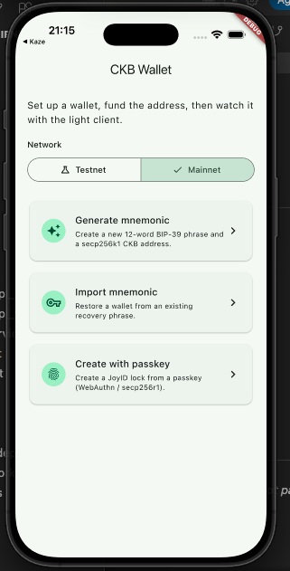
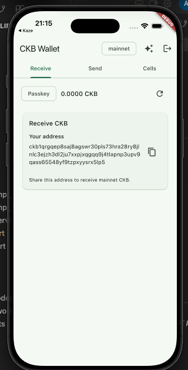

## Builder Track Weekly Final Report — Week 15

**Name:** Telesphore TUGANIMANA  
**Week Ending:** 05-10-2026

### Courses Completed

- **Optimizing the Kaze CKB wallet**
  - Kept the wallet self-custodial: mnemonic or passkey unlocks the same secp256k1-blake160 lock, and Kaze signs locally on device.
  - Tightened receive, send, capacity, and history so the UI refreshes from live cells after funding and after a transfer.
  - Optimized the on-chain CKB → Bitcoin flow (quote, fund, sign, confirm) so the CKB lock and the Bitcoin destination stay visible until both sides settle.
  - Kept the path small: one lock, one light-client sync, then sign and submit.

- **Finalizing the `ckb_flutter_client` package**
  - Finalized the public API: connect to a light-client RPC, sync headers, query cells by lock, then receive and send.
  - Cleaned up the package so other Flutter apps can integrate CKB without reading Kaze or the package source.
  - Example app is the reference: generate / import mnemonic, passkey on create, Testnet / Mainnet, receive and send on the same lock.
  - 
  - 
  - Follow the development of the package on [Ckb Flutter client](https://github.com/tuganimana/ckb-flutter-client)

- **Testing the package with the Kaze main app**
  - Used `ckb_flutter_client` inside the Kaze main app as a real integrator would: add the dependency, connect to the light client, sync, query cells, receive, and send.
  - Checked that the flows behave the same as the example app: create or import with mnemonic and passkey, fundable lock, capacity and history refresh, and send.
  - Used the Kaze test to find and fix gaps in the package API, so integrators do not hit them.

### Key Learnings

- **A finished self-custodial wallet is one lock**
  - Create, unlock, receive, send, and swap all use the same lock. Passkey and mnemonic only change how the seed is unlocked on device.
  - Optimization is mostly freshness: after send or after a swap confirm, capacity and history must come from the same live-cell query.

- **A package is only finished when a real app uses it**
  - The example app shows the happy path. Running the package inside Kaze, a larger app with its own state and UI, shows what the API is missing or makes awkward.
  - Integrators should not fork Kaze. They add `ckb_flutter_client`, point it at a light client, and call connect, sync, query, sign, and send.
  - Protocol code stays in `lib/`; the example in `example/` is the adoption guide.

- **One light client, one source of truth**
  - Kaze and the package read the same live cells from `ckb-light-client`, so balance, history, and send agree.

### Practical Progress

- Kaze CKB wallet:
  - Optimized capacity / history refresh and the CKB → Bitcoin confirm step so both sides of a swap stay on screen.
  - Kept onboarding and local signing (mnemonic and passkey, same fundable lock).
- Flutter package:
  - Finalized `ckb_flutter_client`: install, connect to `ckb-light-client`, sync, cells, capacity, receive, and send.
  - Example wallet remains the path for new integrators.
  - Package work is on [Ckb Flutter client](https://github.com/tuganimana/ckb-flutter-client)
- Package test with Kaze:
  - Ran the package in the Kaze main app and checked connect, sync, receive, and send against the light client.
  - Fixed what the test found, so the package and Kaze behave the same.

### Review of Completed

- **Track:** CKB cells and txs → Rust wallet API → Fiber + RGB++ → Flutter light client → Kaze on-chain CKB↔BTC → package docs and passkey → optimize Kaze, finalize the Flutter client, test it with Kaze.
- **Shipped:** address, mnemonic, transfer, balance/history; Fiber CCH swaps; open Flutter CKB client + example wallet; Kaze self-custodial wallet with on-chain CKB → Bitcoin.
- **This week:** optimized the Kaze wallet; finalized `ckb_flutter_client`; tested the package with the Kaze main app.

### Environment Setup

- Local Flutter/Dart environment for the Kaze wallet and for `ckb_flutter_client` (package + example).
- Kaze main app wired to the package for the integration test.
- Local `ckb-light-client` RPC (`http://127.0.0.1:9000`) for header sync, cell queries, and send.

### Conclusion

This closing week finished the work. I optimized the Kaze self-custodial CKB wallet, finalized `ckb_flutter_client` so other Flutter apps can integrate CKB through a small public API, and tested the package with the Kaze main app. Thank you.
