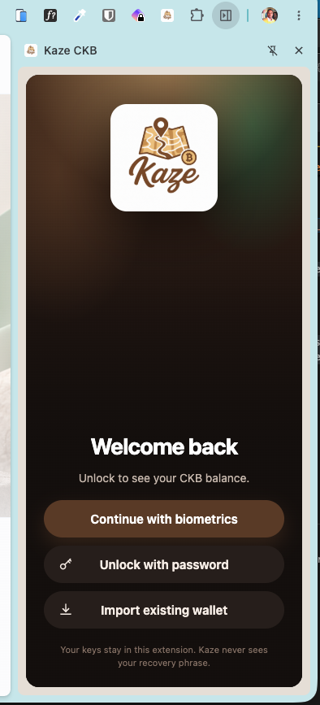
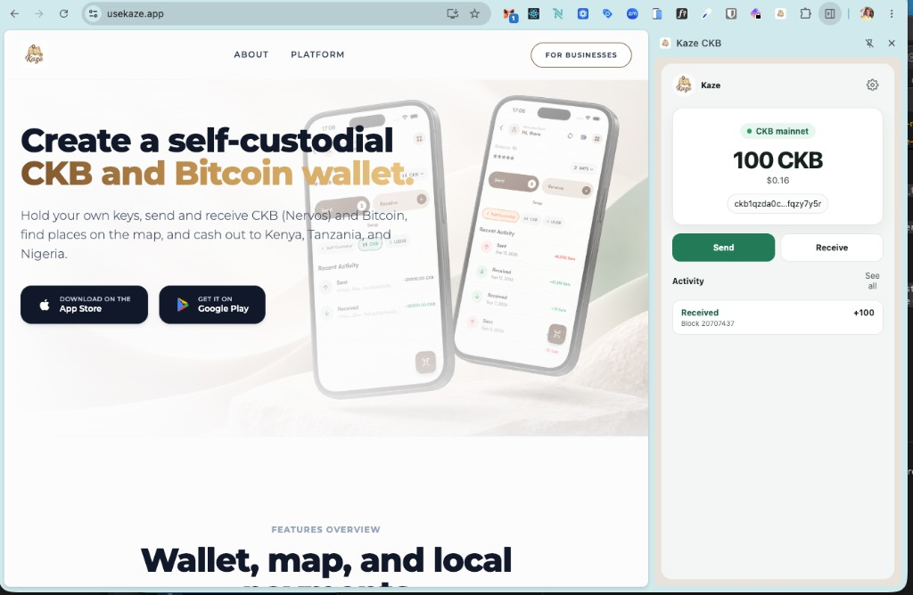

## Builder Track Weekly Final Report — Week 16

**Name:** Telesphore TUGANIMANA  
**Week Ending:** 12-10-2026

### Courses Completed

- **Starting the Kaze Chrome extension**
  - Started a Kaze Chrome extension so a user can open a self-custodial CKB wallet from the browser.
  - Unlock stays on device: biometrics or password, or import an existing wallet. Keys stay in the extension.
  - After unlock the popup shows the CKB mainnet balance, the lock address, Send and Receive, and recent activity.
  - Send is the payout path: the user can pay out CKB from the same wallet that received funds.
  - 
  - 

### Key Learnings

- **The same wallet should open where the user already is**
  - A Chrome extension puts the CKB wallet next to the site, so unlock, balance, receive, and payout happen in the browser.
  - The extension keeps custody local: biometrics or password unlocks the wallet, and Kaze does not see the recovery phrase.

- **Payout starts from a funded lock the user can see**
  - The popup has to show the mainnet balance, the address, and recent activity before Send is useful.
  - Receive and Send share that same wallet, so a credit (for example +100 CKB) is what the user later pays out.

### Practical Progress

- Kaze Chrome extension:
  - Started the extension: unlock with biometrics or password, import an existing wallet, then show the CKB mainnet balance.
  - Receive and Send are in the popup, so a funded wallet can pay out CKB from Chrome.
  - Checked the flow on CKB mainnet: locked welcome screen, then an unlocked wallet at 100 CKB with a received activity row.

### Review of Completed

- **Track:** CKB cells and txs → Rust wallet API → Fiber + RGB++ → Kaze on-chain CKB↔BTC → Kaze Chrome extension for a browser CKB wallet and payout.
- **Shipped:** address, mnemonic, transfer, balance/history; Fiber CCH swaps; Kaze self-custodial wallet with on-chain CKB → Bitcoin.
- **This week:** started the Kaze Chrome extension so a user can hold CKB and pay out from the browser.

### Environment Setup

- Chrome with the Kaze CKB extension loaded, on CKB mainnet, for unlock, balance, receive, and payout.

### Conclusion

This week I started the Kaze Chrome extension. A user can unlock a self-custodial CKB wallet in the browser, see the mainnet balance, and pay out with Send. Thank you.
